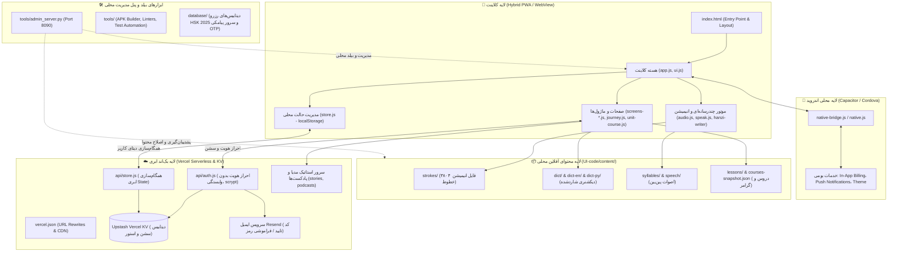
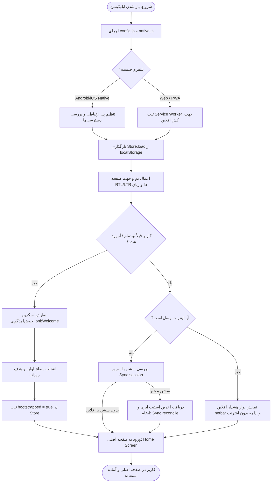
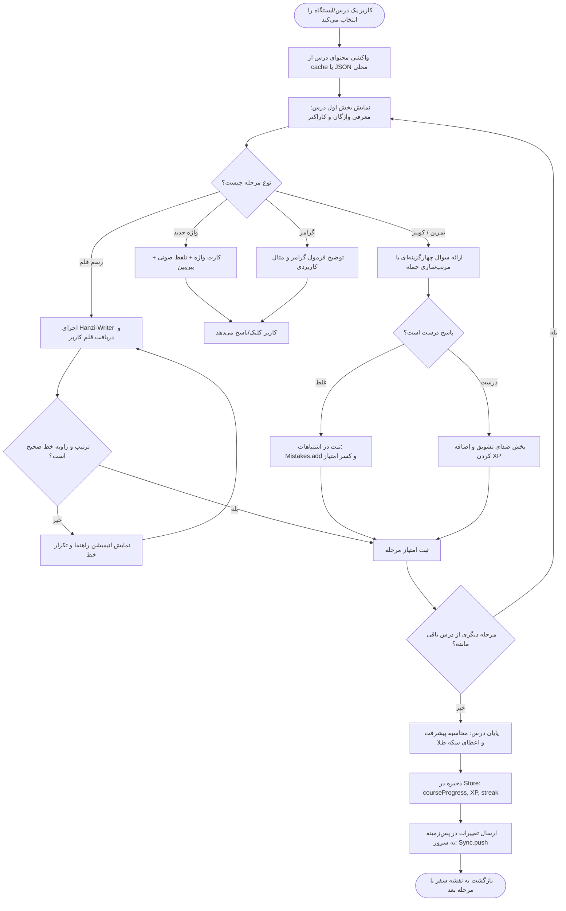
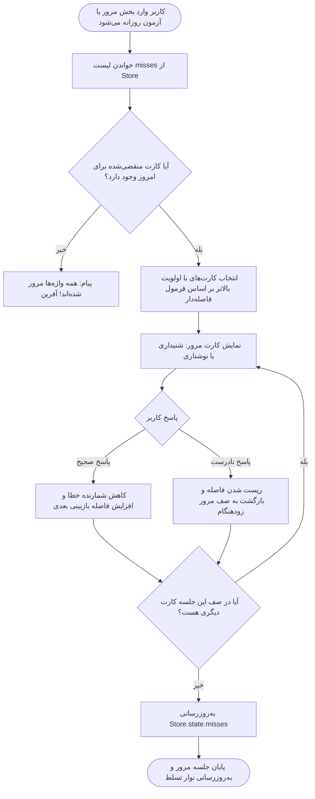
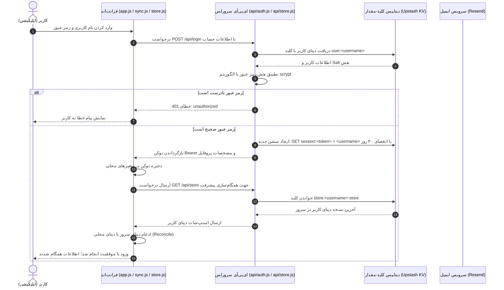

# مستندات و معماری جامع اپلیکیشن Chinify (Kanchinese)

این سند تشریح‌کننده معماری کامل، ساختار فایل‌ها، جریان‌های داده (Data Flows)، چرخه عمر و فلوچارت‌های فنی اپلیکیشن آموزش زبان چینی **Chinify (Kanchinese)** است.

---

## ۱. معرفی و فلسفه طراحی اپلیکیشن

**Chinify** یک پلتفرم جامع، تعاملی و چندزبانه برای یادگیری زبان چینی (سطوح HSK 1 تا HSK 6) است که با تمرکز ویژه بر کاربردهای فارسی و راست‌به‌چپ (RTL) بومی‌سازی شده است.

### ویژگی‌ها و اصول کلیدی معماری:
1. **معماری آفلاین‌محور (Offline-First):** بیش از ۹۵ درصد محتوای آموزشی (دیکشنری، دروس، گرامر، ترتیب رسم قلم‌ها، اصوات پین‌یین) به صورت فشرده داخل خود اپلیکیشن قرار دارد و بدون نیاز به اینترنت کار می‌کند.
2. **کلاینت فوق سبک هیبرید (Zero-Heavy-Frameworks):** استفاده از معماری Vanilla JavaScript ماژولار و بهینه‌سازی‌شده برای WebView در پلتفرم‌های اندروید/iOS/PWA؛ بدون سربار فریم‌ورک‌های سنگین که باعث اجرای روان حتی روی دستگاه‌های ضعیف می‌شود.
3. **موتور رسم قلم تعاملی:** استفاده از کتابخانه `hanzi-writer` با بیش از ۳,۸۰۰ کاراکتر برداری اختصاصی جهت آموزش و تصحیح رسم خطوط کاراکترها.
4. **سیستم مرور فاصله‌دار هوشمند (SRS / Spaced Repetition):** ردگیری اشتباهات کاربر و بازپخش آن‌ها در فواصل زمانی محاسبه‌شده بر اساس منحنی فراموشی ابینگهاوس.
5. **گیمیفیکیشن عمیق:** وجود زنجیره روزانه (Streak)، امتیاز تجربه (XP)، سکه طلا (Gold)، باز کردن جزایر و ایستگاه‌ها در نقشه سفر (Journey)، و چرخ شانس.

---

## ۲. نمای کلی معماری سیستم (High-Level Architecture)

معماری سیستم از ۵ لایه اصلی تشکیل شده است:



---

## ۳. تفکیک و نقش فایل‌ها و ساختار دایرکتوری‌ها

### ۳.۱ ساختار دایرکتوری ریشه (Project Root)
- `UI-code/`: سورس‌کد کامل فرانت‌اند اپلیکیشن هیبرید (HTML, CSS, JS, Assets).
- `vercel-backend/`: بک‌اند سرورلس، پیکربندی Vercel و فایل‌های API.
- `database/`: مخزن و انباره داده‌های staging (پروژه فارسی toonapp، HSK 2025 و سرور auth بومی پیامکی).
- `tools/`: جعبه‌ابزار توسعه، پنل ادمین پایتون، تست‌های مرورگر بدون‌سر (Headless Chrome) و اسکریپت‌های بیلد APK.
- `extracted/`: فایل‌های ساختاریافته‌ی بازشده از APK اصلی جهت مقایسه و پچینگ.
- `START-ADMIN.bat`: اسکریپت راه‌اندازی سریع پنل ادمین محلی در پورت ۸۰۹۰.
- `DATABASE.md`: شناسنامه و مشخصات لایه‌های ذخیره‌سازی داده.
- `Chinify.apk` و فایل‌های کلید (`chinify_release.jks`, `debug.keystore`): خروجی‌های پکیج اندروید.

---

### ۳.۲ ماژول‌های لایه فرانت‌اند (`UI-code/js/`)

| فایل | دسته‌بندی | وظیفه و عملکرد |
|---|---|---|
| `app.js` | **هسته (Core)** | هماهنگ‌کننده کل چرخه حیات، روتر صفحات (`App.screen`)، مدیریت ورود کاربر، لیسنر تغییر سایز و پایش وضعیت اینترنت. |
| `ui.js` | **رابط کاربری (UI Engine)** | مدیریت رندرینگ تب‌بار (`tabbar`)، لایه‌ها (`layer`)، مودال‌ها، نوتیفیکیشن‌های درون‌برنامه‌ای (`toast`)، وضعیت آنلاین/آفلاین (`netbar`). |
| `store.js` | **مدیریت حالت (State)** | پیاده‌سازی الگوی تک‌منبعی استیت (Single Source of Truth)؛ ذخیره، بازیابی و اکسپورت کل دیتای کاربر در `localStorage`. |
| `sync.js` | **همگام‌سازی (Sync)** | تبادل استیت کاربر با بک‌اند ابری (`api/store` و `api/session`)، حل تعارض داده‌ها (Reconciliation) و سشن‌ها. |
| `config.js` | **پیکربندی (Config)** | تعریف متغیرهای محیطی، تنظیم آدرس بک‌اند (`CC.apiBase`)، تشخیص پلتفرم Native (Capacitor/iOS/Android). |
| `native.js` & `native-bridge.js` | **پل ارتباطی بومی (Bridge)** | برقراری ارتباط دوسویه بین کد JS وب‌ویو و لایه جاوای اندروید (تنظیمات نوتیفیکیشن، دارک مود، کنترل ویبره). |
| `i18n.js` & `i18n-fa.js` | **زبان و بومی‌سازی** | واژه‌نامه چندزبانه با تمرکز بر فارسی‌سازی کامل، چیدمان RTL و متن راهنماهای آموزشی. |
| `data.js` & `content.js` | **دسترسی به محتوا** | متدهای بارگذاری، واکشی و کش کردن درس‌ها، تست‌ها و دیکشنری. |
| `unit-course.js` | **موتور دوره‌ها** | ساختار جامع دوره‌های HSK، جزایر آموزشی، زیرمجموعه‌ها، بخش‌های واژگان و گرامر. |
| `screens-learn.js` | **صفحه یادگیری** | رندر تعاملی کارت‌های آموزشی، فلش‌کارت‌ها، آزمون‌های گزینه‌ای و تطبیق کلمات. |
| `screens-strokes.js` & `stroke-data.js` | **موتور رسم قلم** | اتصال به کتابخانه `hanzi-writer`، رسم انیمیشن قلم، دریافت لمس و خط‌کشی کاربر، اعتبارسنجی زاویه و ترتیب خطوط. |
| `screens-vocab.js` & `lookup.js` | **دیکشنری و واژگان** | موتور جستجوی سریع کاراکتر، پین‌یین یا ترجمه در فایل‌های شاردشده دیکشنری، نشان‌دار کردن واژه‌ها. |
| `screens-pinyin.js` & `pinyin-course.js` | **آموزش پین‌یین** | آموزش جدول صوتی حروف صدادار و بی‌صدا و تُن‌های چهارگانه چینی به همراه تست‌های شنیداری. |
| `mistakes.js` | **مرور و SRS** | مدیریت جعبه اشتباهات، تکرار فاصله‌دار، محاسبه ضریب مرور و نمایش کارت‌های منقضی‌شده. |
| `stories.js` & `podcast.js` | **محتوای پیشرفته** | پخش‌کننده چندرسانه‌ای داستان‌ها و پادکست‌های طبقه‌بندی‌شده همراه با متن همگام‌سازی‌شده (Interactive Transcript). |
| `gold.js`, `journey.js`, `goals.js` | **گیمیفیکیشن** | پیگیری پیشرفت کاربر، مدال‌ها، سکه‌ها، اهداف روزانه و حفظ زنجیره یادگیری (Streak). |
| `billing.js` & `screens-pay.js` | **پرداخت و اشتراک** | ارتباط با Google Play In-App Billing و نمایش پلن‌های عضویت ویژه. |

---

### ۳.۳ محتوای آفلاین آموزشی (`UI-code/content/`)
- `strokes/`: ۳,۸۰۴ فایل JSON شامل بردارها و مختصات ترتیب خطوط برای تک‌تک نویسه‌های پرکاربرد چینی.
- `dict/`، `dict-en/`، `dict-py/`: دیتابیس لغت‌نامه تفکیک‌شده بر اساس حرف یا پین‌یین برای جستجوی O(1) بدون کندی حافظه.
- `syllables/` و `speech/`: فایل‌های صوتی استاندارد برای هجاها و واژه‌های کلیدی.
- `lessons/`: ساختار درختی واحدهای درسی دوره‌ها (HSK1 تا HSK6).
- `stories.json` و `podcast.json`: سناریوهای داستانی همراه با فایل‌های تکمیلی در `pods/`.

---

### ۳.۴ معماری بک‌اند ابری (`vercel-backend/`)
بک‌اند روی پلتفرم بدون‌سرور (Serverless) Vercel میزبانی شده و دارای مصرف منابع نزدیک به صفر است:
- **مسیرها (`vercel.json`):** بازنویسی درخواست‌های ورودی به دو میکروسرویس اصلی و فایل‌های محتوایی استاتیک:
  - `/api/auth*` $\rightarrow$ اتصال به `api/auth.js`
  - `/api/store*` $\rightarrow$ اتصال به `api/store.js`
  - `/api/stories/*` و `/api/podcast/*` $\rightarrow$ فایل‌های JSON محتوایی
- **سرویس احراز هویت (`api/auth.js`):**
  - بدون نیاز به دیتابیس سنگین SQL؛ اتصال از طریق REST به Upstash Vercel KV.
  - رمزنگاری پسوردها با الگوریتم امنیتی `scrypt` به همراه Salt اختصاصی برای هر کاربر.
  - تولید توکن‌های Bearer برای سشن‌های ۳۰ روزه ذخیره‌شده در ردیس با کلید `session:<token>`.
  - ارسال ایمیل بازیابی رمز و خوش‌آمدگویی با API سرویس Resend.
- **سرویس ذخیره پیشرفت (`api/store.js`):**
  - دریافت اسنپ‌شات وضعیت اپلیکیشن از کلاینت و ذخیره آن با کلید `store:<username>:<key>`.
  - امکان دریافت آخرین وضعیت با ارسال توکن معتبر سشن کاربر.

---

## ۴. فلوچارت‌های جامع فرآیندهای اپلیکیشن

### ۴.۱ فلوچارت بوت و اجرای اولیه اپلیکیشن (Lifecycle & Boot Flowchart)



---

### ۴.۲ فلوچارت چرخه یادگیری درس و تمرین (Learning & Practice Flowchart)



---

### ۴.۳ فلوچارت سیستم مرور فاصله‌دار اشتباهات (Spaced Repetition / SRS Flowchart)



---

### ۴.۴ فلوچارت احراز هویت و همگام‌سازی ابری (Auth & Cloud Sync Flowchart)



---

## ۵. راهنمای ابزارها و اجرای محیط توسعه (Development & Tooling)

### ۵.۱ اجرای پنل مدیریت محلی (Admin Panel)
برای ویرایش درس‌ها، بررسی ساختار، پشتیبان‌گیری و ارزیابی محتوا:
```bat
# اجرای فایل bat در ریشه پروژه
START-ADMIN.bat
```
این اسکریپت سرور سبک پایتون `tools/admin_server.py` را روی پورت `8090` اجرا کرده و صفحه مدیریت `http://127.0.0.1:8090/admin` را باز می‌کند.

### ۵.۲ اجرای وب اپلیکیشن بدون نیاز به بیلد
کافیست یک وب‌سرور استاتیک روی پوشه `UI-code` اجرا شود:
```bash
cd UI-code
python -m http.server 8080
# باز کردن آدرس http://localhost:8080 در مرورگر
```

### ۵.۳ دیپلوی و به‌روزرسانی بک‌اند Vercel
```bash
cd vercel-backend
# استقرار مستقیم روی پروژه Vercel
vercel --prod --yes
```

---

## ۶. جمع‌بندی وضعیت سیستم و پتانسیل‌های آماده ادغام

1. **پایداری کامل هسته کلاینت:** اپلیکیشن در وضعیت کامپایل‌شده APK و نسخه وب دارای ثبات کامل بوده و تمام دارایی‌های متنی و صوتی به شکل آفلاین در دسترس هستند.
2. **پشتیبانی کامل از زبان فارسی:** لایه‌های رابط کاربری و گرامر دارای کلاس‌های استایل اختصاصی برای زبان فارسی و چیدمان RTL هستند.
3. **دیتابیس‌های آماده مرحله Staging (`database/`):**
   - مخزن کامل کاراکترها و دیکشنری HSK 2025 و ترجمه‌های فارسی آماده است تا در نسخه‌های آتی مستقیماً در لایه `UI-code/content/` جایگزین یا با آن ترکیب شوند.
   - سرور پیامکی OTP واژه‌نگار در پوشه `database/server/` به عنوان بک‌اند پشتیبان برای کاربران ایرانی در دسترس است.
